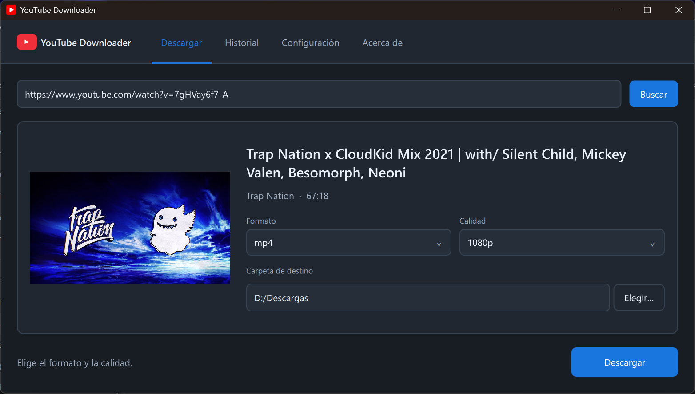

# YouTube Downloader 📹

Aplicación de escritorio para Windows que descarga vídeo y audio de YouTube. La interfaz está hecha con Python y PySide6 (Qt Quick), y las descargas con yt-dlp y FFmpeg.

[](https://github.com/cali-sb/Youtube-Downloader/releases/latest)



## Características ✨

### Descarga
- **Vídeo**: MP4, MKV, AVI, WEBM y MOV
- **Audio**: MP3, AAC, FLAC, OGG, WAV y M4A, a 128, 192 o 320 kbps
- **Calidades del propio vídeo**: al buscar un enlace, el selector solo ofrece las resoluciones que tiene ese vídeo
- **Vista previa**: miniatura, título, canal y duración antes de descargar
- **Progreso con velocidad** en tiempo real y botón para cancelar
- Solo se descarga el enlace que se ha buscado: si cambias la URL, hay que volver a pulsar **Buscar**

### Interfaz
- Ventana redimensionable con cuatro apartados: **Descargar**, **Historial**, **Configuración** y **Acerca de**
- Temas **Claro**, **Oscuro** y **Sistema** (sigue la apariencia de Windows), con el mismo acento azul en todos
- Pide confirmación si cierras la ventana con una descarga o una actualización en curso

### Historial
- Cada descarga con su miniatura, título, canal, fecha, formato, calidad, tamaño y carpeta
- Botón **Abrir** que muestra el archivo seleccionado en el Explorador
- **Limpiar historial**, con confirmación; borra los registros, no los archivos descargados

### Configuración
- Carpeta predeterminada de descarga
- Formato predeterminado y calidad de vídeo y de audio predeterminadas
- Tema, con vista previa inmediata
- Abrir la carpeta al terminar una descarga
- Buscar actualizaciones al iniciar (activado por defecto)
- Se guarda con **Guardar configuración** en `%LOCALAPPDATA%\YouTubeDownloader\config.json`; el historial está en la misma carpeta

### Acerca de y actualizaciones
- Versión instalada y enlace al proyecto
- **Buscar actualizaciones** consulta las releases de GitHub y muestra las novedades; si hay una versión nueva, la pestaña lo indica
- **Descargar e instalar**: baja el instalador, comprueba su tamaño y su huella SHA-256 con la publicada en GitHub, lo ejecuta (Windows pide permisos de administrador) y vuelve a abrir la app ya actualizada. La configuración y el historial se conservan

## Instalación ⚙️

### Opción 1 — Instalador (recomendado)

Descarga `YouTubeDownloader-Setup-vX.Y.Z.exe` de la [última release](https://github.com/cali-sb/Youtube-Downloader/releases/latest) y ejecútalo. Incluye todo lo necesario, FFmpeg también; no hace falta instalar Python. Si ya tienes una versión anterior, instálalo encima o actualiza desde **Acerca de**.

### Opción 2 — Desde el código fuente

```powershell
git clone https://github.com/cali-sb/Youtube-Downloader.git
cd Youtube-Downloader
python -m venv venv
venv\Scripts\activate
pip install -r requirements.txt
python main.py
```

FFmpeg tiene que estar en el `PATH` o en la raíz del proyecto.

## Uso 🚀

1. Pega el enlace del vídeo y pulsa **Buscar**.
2. Elige el **formato**, la **calidad** y la **carpeta de destino**.
3. Pulsa **Descargar**. Puedes cancelar mientras se descarga.
4. Lo descargado queda en **Historial**, desde donde puedes abrir el archivo.

## Requisitos 🔧

- Windows 10 u 11 de 64 bits
- Conexión a Internet
- Desde el código: desarrollada y probada con Python 3.13, PySide6 6.12 y PyInstaller 6.19

## Dependencias principales

| Paquete | Uso |
|---|---|
| yt-dlp | Motor de descarga |
| PySide6 (Qt Quick / QML) | Interfaz gráfica |
| FFmpeg | Conversión y mezcla de formatos |
| requests | Descarga de actualizaciones |
| packaging | Comparación de versiones |
| Pillow | Regenerar el icono (`create_icon.py`) |

## Compilar y publicar una versión 📦

La versión está solo en `src/version.py`; el `.spec` de PyInstaller y el instalador la toman de ahí.

1. Cambia `__version__` en `src/version.py`.
2. Ejecuta las pruebas y el build:
   ```powershell
   .\venv\Scripts\python.exe -m unittest discover -s tests -v
   .\build.ps1
   ```
   `build.ps1` necesita PyInstaller en el `venv`, [Inno Setup 6](https://jrsoftware.org/isinfo.php) y FFmpeg con sus DLL en `C:\ffmpeg\bin`. Compila la app en una carpeta (`dist\YouTubeDownloader\`, el `.exe` no funciona suelto), comprueba que arranca y deja el instalador en `installer_output\` junto con su SHA-256.
3. Crea una release en GitHub con la versión como etiqueta (p. ej. `1.0.0`) y adjunta `YouTubeDownloader-Setup-vX.Y.Z.exe`. El nombre del fichero tiene que contener `Setup` y acabar en `.exe` para que la app lo encuentre.

## Estructura del proyecto

```
Youtube-Downloader/
├── src/
│   ├── qt_gui.py       # Puente Python ↔ QML y arranque de la app
│   ├── qml/Main.qml    # Interfaz (Qt Quick)
│   ├── gui.py          # Entrada de compatibilidad (remite a qt_gui)
│   ├── downloader.py   # Lógica de descarga
│   ├── history.py      # Gestión del historial
│   ├── config.py       # Gestión de configuración
│   ├── updater.py      # Búsqueda e instalación de actualizaciones
│   └── version.py      # Versión de la app (única fuente)
├── assets/icon.ico     # Icono de la aplicación
├── docs/               # Capturas de pantalla
├── tests/              # Pruebas de la interfaz (unittest, sin conexión)
├── create_icon.py      # Script para regenerar el icono
├── YouTubeDownloader.spec  # Empaquetado PyInstaller
├── installer.iss       # Instalador de Inno Setup
├── build.ps1           # Compila la app y el instalador
├── main.py             # Punto de entrada
├── requirements.txt
└── readme.MD
```
